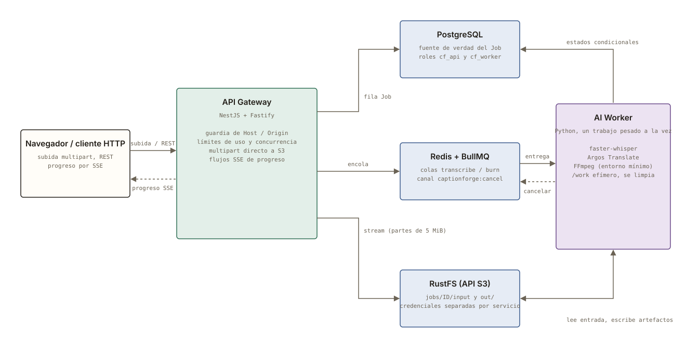

# CaptionForge

[English](README.md) | **Español**

[](https://github.com/Bryandero98/captionforge/actions/workflows/monorepo.yml)
[](LICENSE)

Subtítulos automáticos para video, gratuitos - transcripción, traducción y subtítulos quemados -
sin marca de agua ni límite mensual, y hoy sin cuenta. CaptionForge empezó como una herramienta
local de un solo proceso y se está reconstruyendo como un **servicio distribuido dirigido por
eventos**, pensado para resistir fallos y carga: topes explícitos, apagado ordenado y recuperación
de trabajos huérfanos. Sus límites conocidos se declaran, no se esconden.

- **Transcripción** con [faster-whisper](https://github.com/SYSTRAN/faster-whisper),
  **traducción** a cualquier idioma con [argos-translate](https://github.com/argosopentech/argos-translate)
  y **subtítulos quemados** con [ffmpeg](https://ffmpeg.org/) en cuatro estilos (Moderno, TikTok en
  negrita, YouTube clásico y Mínimo), con resaltado opcional palabra por palabra (karaoke).
- **Salida** en `.srt` (y `.vtt` y `.ass` en el paquete local), o el video con los subtítulos quemados.
- **Editable**: corrige el texto y ajusta los tiempos antes de quemar; una edición desactualizada se
  rechaza (`409`) en lugar de pisar en silencio la de otra persona.
- **Progreso en vivo** por Server-Sent Events, sin consultar cada poco.

> **Dos formas de usarlo**
>
> | | Qué es | Estado |
> |---|---|---|
> | **Paquete local** | `pip install` + `captionforge serve` (Python 3.10+): un proceso, un video a la vez, nada sale de tu equipo. | Publicado en PyPI. Ver [`legacy/`](legacy/README.es.md). |
> | **Servicio (este monorepo)** | API Gateway + cola + AI Worker + almacenamiento de objetos, pensado para varios trabajos y varias personas. | API y worker hechos; cliente web y cuentas pendientes. |

## Puesta en marcha (un solo comando)

Lo único que hace falta es Docker (Docker Desktop en Windows y macOS).

```sh
./start.sh        # macOS / Linux
start.bat         # Windows (doble clic o desde una terminal)
```

El script comprueba que `docker` y `docker compose` funcionan, crea `.env` desde `.env.example` con contraseñas aleatorias si no existe (un `.env` existente nunca se toca), ejecuta `docker compose --profile app up -d --build`, espera a la API y muestra la dirección: **http://localhost:3000** (o el puerto que fijes en `CF_PORT`, ver [Cambiar el puerto](#cambiar-el-puerto-recomendado-si-el-3000-está-ocupado)). La primera vez construye las imágenes (varios minutos) y la primera transcripción descarga el modelo de Whisper. Todo se publica solo en `127.0.0.1`. Se apaga con `docker compose --profile app down`. La identificación de hablantes y la GPU son opcionales y necesitan pasos extra (ver la [guía de uso](docs/guia-de-uso.md#activar-la-identificación-de-hablantes) y el compose).

### Cambiar el puerto (recomendado si el 3000 está ocupado)

CaptionForge se abre por defecto en el **puerto 3000** de tu equipo. Si otro programa ya lo usa (otra aplicación de desarrollo, por ejemplo), elige otro: te recomendamos hacerlo en lugar de detener el otro programa:

1. Abre el archivo `.env` (lo crean `start.sh` / `start.bat` la primera vez) y cambia la línea `CF_PORT=3000` por un puerto libre, por ejemplo `CF_PORT=3100`. Usa un número de 1 a 65535, mejor por encima de 1024.
2. Vuelve a ejecutar `./start.sh` (o `start.bat`). Leen el mismo valor, levantan todo en ese puerto y muestran la nueva dirección (`http://localhost:3100`). `docker compose` también lee `CF_PORT` desde `.env`.
3. También puedes fijarlo solo para una ejecución: `CF_PORT=3100 ./start.sh` (macOS/Linux) o `set CF_PORT=3100` y luego `start.bat` (Windows).

El puerto solo se publica en `127.0.0.1` (tu equipo); dentro del contenedor sigue siendo el 3000. Si `CF_PORT` no es un puerto válido, los scripts se detienen con un mensaje claro antes de levantar nada. Si usas el inicio de sesión con GitHub con otro puerto, acuerda actualizar la dirección de retorno (`PUBLIC_URL`) de la aplicación OAuth.

### Solución de problemas

- **Un trabajo se queda en `QUEUED` y no se procesa** (visto una vez en el primer arranque en frío, sin reproducirse después): reinicia el worker con `docker compose --profile app restart ai-worker`. El trabajo en cola se retoma enseguida; no se pierde nada.

## Puesta en marcha (desarrollo)

Requisitos: Docker, Node >= 22 y Python >= 3.11.

```sh
npm install
cp .env.example .env        # rellena cada valor (ver la nota de abajo)
npm run infra:up            # PostgreSQL, Redis y S3 (RustFS)
npm run infra:verify        # permisos: lo permitido funciona y lo prohibido falla
```

Genera un secreto con `node -e "console.log(require('crypto').randomBytes(18).toString('hex'))"`.
Los secretos viven en `.env` (ignorado por git), nunca en el repositorio.

Los comandos de contratos y de la prueba de humo necesitan sus entornos de Python, que se crean una vez:

```sh
python -m venv packages/contracts/.venv
packages/contracts/.venv/bin/python -m pip install -r packages/contracts/requirements-dev.txt
python -m venv tools/smoke/.venv
tools/smoke/.venv/bin/python -m pip install -r tools/smoke/requirements.txt
```

(en Windows, `Scripts\python.exe` en lugar de `bin/python`).

En desarrollo local, `api-gateway` y `ai-worker` se ejecutan **de forma nativa** contra la
infraestructura dockerizada, para ahorrar RAM. Para un despliegue completo:

```sh
docker compose --profile app up -d --build
docker compose ps           # salud de cada servicio
npm run e2e                 # sube un video, lo transcribe, edita un subtítulo, lo quema y descarga el MP4
docker compose --profile app down   # apaga todo al terminar (`npm run infra:down` solo apaga la infraestructura)
```

### Pruébalo

```sh
# Crea un trabajo de transcripción (el JSON `options` va antes de `file`;
# modelSize: base | small | medium, translateTo: un código de idioma o null)
curl -F 'options={"modelSize":"base","translateTo":"es"}' -F file=@clip.mp4 http://127.0.0.1:3000/v1/jobs/transcribe
# -> 202 { "id": "..." }

# Síguelo en vivo (Server-Sent Events) y lee el resultado
curl -N http://127.0.0.1:3000/v1/jobs/<id>/events
curl -OJ http://127.0.0.1:3000/v1/jobs/<id>/artifacts/srt
```

Cada llamada necesita tu clave de API: añade `-H "X-API-Key: <clave>"` (la `DEFAULT_API_KEY` de tu `.env`; también sirve `Authorization: Bearer <clave>`). Un trabajo pertenece al tenant dueño de la clave: otra clave recibe `404`, nunca `403`.

## Idiomas compatibles

Los dos motores funcionan en local, sin cuenta y sin costo por uso.

**Transcripción (faster-whisper / Whisper): 100 idiomas.** La lista sale de la versión de faster-whisper fijada en este repositorio, así que el selector de idioma de la aplicación siempre coincide con ella. La calidad varía mucho: es mejor en idiomas muy hablados (inglés, español, francés, alemán, portugués, italiano, japonés...) y claramente peor en los de pocos recursos. Deja la detección automática o elige el idioma si el audio es corto o con ruido.

afrikáans, albanés, alemán, amárico, árabe, armenio, asamés, azerbaiyano, baskir, bengalí, bielorruso, birmano, bosnio, bretón, búlgaro, canarés, cantonés, catalán, checo, chino, cingalés, coreano, criollo haitiano, croata, danés, eslovaco, esloveno, español, estonio, euskera, feroés, filipino, finés, francés, galés, gallego, georgiano, griego, guyaratí, hausa, hawaiano, hebreo, hindi, húngaro, indonesio, inglés, islandés, italiano, japonés, javanés, jemer, kazajo, lao, latín, letón, lingala, lituano, luxemburgués, macedonio, malayálam, malayo, malgache, maltés, maorí, maratí, mongol, neerlandés, nepalí, noruego, noruego nynorsk, occitano, pastún, persa, polaco, portugués, punyabí, rumano, ruso, sánscrito, serbio, shona, sindi, somalí, suajili, sueco, sundanés, tailandés, tamil, tártaro, tayiko, telugu, tibetano, turco, turcomano, ucraniano, urdu, uzbeko, vietnamita, yidis, yoruba.

**Traducción (Argos Translate): 50 idiomas**, según el índice oficial de paquetes (consultado el 2026-10-24):

albanés, alemán, árabe, azerbaiyano, bengalí, búlgaro, catalán, checo, chino, chino (tradicional), coreano, danés, eslovaco, esloveno, español, esperanto, estonio, euskera, filipino, finés, francés, gallego, griego, hebreo, hindi, húngaro, indonesio, inglés, irlandés, italiano, japonés, kirguís, letón, lituano, malayo, neerlandés, noruego bokmal, persa, polaco, portugués, portugués (Brasil), rumano, ruso, suajili, sueco, tailandés, turco, ucraniano, urdu, vietnamita.

Lo que conviene saber de la traducción:
- Todos los modelos de Argos van **desde o hacia el inglés**. Un par como español → alemán se traduce **pasando por el inglés** (dos pasos), por lo que suele ser menos preciso que un par que incluya el inglés.
- El modelo de cada par se **descarga la primera vez que se usa** (hace falta internet una vez, unos cientos de MB por par) y después se reutiliza sin conexión.
- La aplicación ofrece como destino todos los idiomas de transcripción, pero Argos solo cubre los 50 de arriba; con cualquier otro destino el trabajo termina con un error claro. Para otros idiomas o más calidad puedes usar un proveedor externo con tu propia clave (BYOK).

## API

Todo cuelga de `/v1/jobs`. El worker escribe el estado del trabajo en PostgreSQL y el API lo lee. Todas las rutas de `/v1/jobs` piden `X-API-Key: <clave>` (o `Authorization: Bearer <clave>`); `/health` y
`/v1/capabilities` quedan abiertas. Las claves y los tenants se explican en el [ADR 0015](docs/adr/0015-tenencia-y-claves-de-api.md).

| Método y ruta | Qué hace |
|---|---|
| `POST /v1/jobs/transcribe` | Multipart. Sube el video a S3 mientras llega. `202` |
| `GET /v1/capabilities` | Funciones opcionales de este servidor (`{ "diarization": { "enabled": true } }`); la web oculta o desactiva lo que falte |
| `GET /v1/jobs` | Tus trabajos, del más reciente al más antiguo (`?limit=` 1-100, por defecto 20; `?cursor=<último id>`; nunca más de 100 por página); solo los del tenant de la clave |
| `GET /v1/jobs/:id` | Estado, etapa, porcentaje, error y resultado |
| `GET /v1/jobs/:id/events` | Progreso por SSE hasta un estado final |
| `POST /v1/jobs/:id/cancel` | Cancela: en cola se quita; en curso se avisa al worker |
| `GET /v1/jobs/:id/segments` | Subtítulos con `index` y el `etag` vigente |
| `PUT /v1/jobs/:id/segments` | Edita texto y/o tiempos por índice (`etag` opcional: `409` si cambiaron) |
| `GET /v1/quality/profiles` | Normas de calidad de subtítulos (`netflix`, `netflix-es`, `bbc`, `accessible`, `shorts`) con sus límites y cuánto se verificó cada una |
| `GET /v1/jobs/:id/quality` | Informe de calidad de los subtítulos contra una norma (`?profile=`): caracteres por segundo y por línea, duración, separación y solapes |
| `POST /v1/jobs/:id/quality/fix` | Propone un arreglo solo de tiempos de final y saltos de línea (nunca el texto); se aplica con `PUT …/segments` y el mismo `etag` |
| `POST /v1/jobs/:id/burn` | Quema los subtítulos actuales: `{ "style": "modern", "karaoke": false }`. `202` |
| `GET /v1/jobs/:id/artifacts/:name` | `srt`, `segments`, `waveform` (transcripción) o `video` (quemado); admite `Range` |

## Arquitectura

<picture>
  <source media="(prefers-color-scheme: dark)" srcset="docs/architecture-dark.es.svg">
  
</picture>

Dos procesos que no comparten disco ni memoria: un **API Gateway** que atiende a las personas
usuarias y un **AI Worker** que hace el trabajo pesado (Whisper, ffmpeg, traducción). Se hablan por
una cola (Redis/BullMQ) y por un almacén de objetos (S3); los mensajes son esquemas JSON versionados
y los archivos se nombran con `bucket` + `objectKey`, nunca con URLs. Cada servicio tiene el mínimo
privilegio que le basta: roles de base de datos y políticas S3 separados, de modo que un worker
comprometido no puede borrar tablas ni salir de `jobs/`.

```text
apps/
  api-gateway/       NestJS 12 + Fastify + Prisma: subida a S3, cola, SSE, cancelación, subtítulos, quemado
    src/security/      guardia de Host/Origin, limitador de concurrencia, clave de cliente
    src/storage/       subida multipart en streaming a S3
  ai-worker/         Python: consumidor de BullMQ, Whisper, traducción, ffmpeg; estado directo a PostgreSQL
packages/
  contracts/         Esquemas JSON (fuente de verdad) + tipos TypeScript y modelos Pydantic generados
docker/              roles de PostgreSQL, buckets y políticas de S3, comprobación de permisos
tools/
  smoke/             prueba de contrato Node -> Redis -> Python con BullMQ real
  e2e/               extremo a extremo contra el stack completo en contenedores
legacy/              el paquete pip local publicado (CLI + servidor web local)
docs/
  adr/               por qué se tomó cada decisión
  architecture.md    componentes, quién puede qué, reglas del worker, fases
  architecture_and_security.md   postura de seguridad y resiliencia, con límites declarados
```

### Seguridad y resiliencia

Diseñado para que el modo de fallo sea «rechazar, cortar o no hacer nada» y no «ejecutar sin
comprobar»:

- **Ataques desde el navegador:** guardia fail-closed de `Host` / `Origin` / `Sec-Fetch-Site` y lista
  cerrada de CORS contra CSRF y DNS rebinding ([ADR 0011](docs/adr/0011-origen-y-host-fail-closed-contra-paginas-ajenas.md)).
- **Memoria y sockets acotados:** las subidas van a S3 en partes de 5 MiB con tope total y por
  cliente y un ritmo mínimo; los flujos SSE tienen un tope global, uno por cliente y una duración
  máxima.
- **Los secretos no llegan a los subprocesos:** ffmpeg corre con un entorno de lista blanca.
- **Apagado ordenado:** el worker deja terminar el trabajo en curso dentro de un plazo; pasado el
  plazo le pide parar y lo cierra como fallido, y limpia su volumen efímero `/work`, también los
  restos de una caída al arrancar.
- **Cadena de suministro:** acciones de GitHub fijadas por SHA, permisos de solo lectura en los
  workflows comprobados en el CI y un workflow de publicación preparado para Trusted Publishing
  (OIDC) en PyPI, sin token de larga vida en el workflow.

El cuadro completo, con lo que **todavía no** está cubierto, está en
[docs/architecture_and_security.md](docs/architecture_and_security.md). Los cambios por versión están en el [CHANGELOG](CHANGELOG.md); la operación del secreto de las claves externas, en el [runbook de `APP_SECRET`](docs/runbook-app-secret.md) ([ADR 0020](docs/adr/0020-ia-avanzada-y-claves-externas-byok.md)).

## Comandos

| Comando | Qué hace |
|---|---|
| `npm run contracts:gen` / `contracts:check` / `contracts:test` | Regenera los tipos TypeScript y los modelos Pydantic; falla si se desvían (se usa en CI); prueba ambos con los mismos ejemplos |
| `npm run infra:up` / `infra:down` | Levanta o apaga PostgreSQL, Redis y S3 |
| `npm run infra:verify` | Comprueba permisos: lo permitido funciona y lo prohibido falla |
| `npm run smoke` | Productor Node -> Redis -> worker Python con BullMQ real |
| `npm run infra:logs` | Sigue los registros de la infraestructura |
| `npm run migrate -w @captionforge/api-gateway` | Aplica las migraciones de Prisma con el rol dueño (`cf_owner`) |
| `npm test -w @captionforge/api-gateway` | Pruebas del API contra PostgreSQL, Redis y S3 reales |
| `npm run worker:test` | Pruebas del worker con ffmpeg, PostgreSQL, Redis y S3 (Whisper simulado; `WHISPER_E2E=1` usa el real) |
| `npm run e2e` | Extremo a extremo contra el stack completo en contenedores (descarga el modelo la primera vez) |
| `npm run workflows:check` | Falla si un workflow no tiene permisos de solo lectura o una acción no está fijada por SHA |
| `npm run compose:check` | Valida `docker-compose.yml` con y sin el perfil `app` |

## Estado y hoja de ruta

| Fase | Contenido | Estado |
|---|---|---|
| 0-3 | Monorepo, contratos, infraestructura, API Gateway, AI Worker | Hecha |
| 4a | Edición de subtítulos, cola de quemado, descarga con `Range` | Hecha |
| 5a | Endurecimiento: límites, trabajos huérfanos, guardia Host/Origin, cadena de suministro | Hecha |
| **4b** | **Cliente web sobre el nuevo API** (REST, subida multipart asíncrona, SSE en vivo) | **Siguiente** |
| 5b | Cuentas de personas usuarias, propiedad de los trabajos, observabilidad, despliegue | Pendiente |

Después del cliente web, ideas que valen la pena y que no se han empezado a propósito:

- **Diarización de hablantes** («quién dijo qué») - [issue #4](https://github.com/Bryandero98/captionforge/issues/4): implementada como opción «identificar quién habla» del servicio (pyannote 3.1 en un subproceso, necesita un token de Hugging Face de solo lectura en el worker y vuelve a la transcripción normal si falla; ver el [ADR 0014](docs/adr/0014-identificar-quien-habla-pyannote.md) y la [guía de uso](docs/guia-de-uso.md#activar-la-identificación-de-hablantes)).
- **Separación de voz y fuente** antes de transcribir, para audio con ruido - [issue #5](https://github.com/Bryandero98/captionforge/issues/5).
- **Un instalador nativo completo** del paquete local (multiplataforma, firmado, con ffmpeg incluido) - [issue #2](https://github.com/Bryandero98/captionforge/issues/2); ya existe un primer paso en [`legacy/`](legacy/README.es.md).
- **Aislar ffmpeg** en su propio usuario o contenedor (el entorno mínimo evita la herencia accidental
  de secretos, no un ffmpeg ya comprometido).

## Decisiones

Los porqués están en [docs/adr/](docs/adr): contratos por esquema JSON, `objectKey` en vez de URLs,
BullMQ con worker Python, Python directo a PostgreSQL, almacenamiento S3 con RustFS, reglas del worker, desarrollo local, el
API en NestJS, por qué el worker reutiliza `legacy/` en lugar de copiarlo, el endurecimiento del API
y la guardia de Host/Origin que falla cerrada.

## Contribuir

Las sugerencias sobre lo que CaptionForge debería hacer después son bienvenidas, no solo los
reportes de errores: abre un issue con lo que quisieras, aunque sea a grandes rasgos. Mira
[CONTRIBUTING.md](CONTRIBUTING.md) para enviar un PR.

## Apoya este proyecto

CaptionForge es gratuito para uso personal, educativo y no comercial bajo la licencia BSL, y lo seguirá siendo. Una propina no desbloquea nada; va hacia
pagar algún día un servidor de verdad, para que quien no quiera instalar nada también tenga esa
opción:

- **Ko-fi:** [ko-fi.com/bryandero98](https://ko-fi.com/bryandero98)
- **USDT (TRC20):** `TEG4Kk2qXYMQ4mHNd7dPhSPRyT14CGr2or` - verifica que la red sea **TRC20** antes de
  enviar; una transferencia por otra red no se puede recuperar.

## Contribuciones

CaptionForge utiliza un modelo Business Source. El uso comercial o en producción requiere licencia. Los Pull Requests para sugerir mejoras o corregir errores son bienvenidos; al enviar un PR, el contribuyente cede los derechos comerciales sobre dicho código al autor original.

## Licencia

[Business Source License 1.1](LICENSE) (Licenciante: Bryan Andrés Delgado Rodríguez). Pasa a Apache 2.0 el 2030-10-23.
