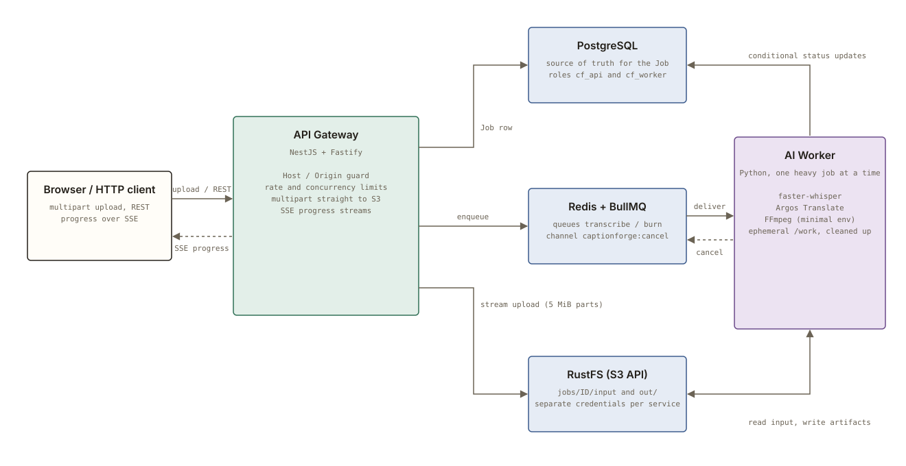

# CaptionForge

**English** | [Español](README.es.md)

[](https://github.com/Bryandero98/captionforge/actions/workflows/monorepo.yml)
[](LICENSE)

Free automatic video captions - transcription, translation and burned-in
subtitles - without a watermark or a monthly limit, and today without an account.
CaptionForge started as a local, single-process tool and is now being rebuilt as an
**event-driven distributed service** designed to withstand failures and load: explicit
caps, graceful shutdown and recovery of orphaned jobs. Its known limits are declared, not hidden.

- **Transcription** with [faster-whisper](https://github.com/SYSTRAN/faster-whisper),
  **translation** to any language with [argos-translate](https://github.com/argosopentech/argos-translate),
  and **burned-in subtitles** with [ffmpeg](https://ffmpeg.org/) in four caption styles
  (Modern, TikTok bold, YouTube classic, Minimal), with optional word-by-word karaoke.
- **Output** as `.srt` (plus `.vtt` and `.ass` in the local package), or the video with the captions burned in.
- **Editable**: fix text and retime segments before burning; a stale edit is rejected (`409`)
  instead of silently overwriting someone else's.
- **Live progress** over Server-Sent Events, not polling.

> **Two ways to run it**
>
> | | What it is | Status |
> |---|---|---|
> | **Local package** | `pip install` + `captionforge serve` (Python 3.10+): one process, one video at a time, nothing leaves your machine. | Published on PyPI. See [`legacy/`](legacy/README.md). |
> | **Service (this monorepo)** | API Gateway + queue + AI Worker + object storage, built to run several jobs and several users. | API and worker done; web client feature-complete (upload queue, live progress, editor, downloads, burned-in video; 6 languages), user accounts pending. |

## Quickstart (one command)

The only requirement is Docker (Docker Desktop on Windows and macOS).

```sh
./start.sh        # macOS / Linux
start.bat         # Windows (double-click or run it from a terminal)
```

The script checks that `docker` and `docker compose` work, creates `.env` from `.env.example` with random passwords if it does not exist (an existing `.env` is never touched), runs `docker compose --profile app up -d --build`, waits for the API and prints the address: **http://localhost:3000** (or the port you set in `CF_PORT`, see [Change the port](#change-the-port-recommended-if-3000-is-taken)). The first run builds the images (several minutes) and the first transcription downloads the Whisper model. Everything is published on `127.0.0.1` only. Turn it off with `docker compose --profile app down`. Speaker identification and GPU are optional and need extra setup (see the [user guide](docs/user-guide.md#turning-on-speaker-identification) and the compose file).

### Change the port (recommended if 3000 is taken)

CaptionForge opens on **port 3000** of your computer by default. If another program already uses it (another development app, for instance), pick a different one - we suggest you do, instead of stopping the other program:

1. Open the `.env` file (created by `start.sh` / `start.bat` the first time) and change the line `CF_PORT=3000` to a free port, for example `CF_PORT=3100`. Use a number from 1 to 65535, preferably above 1024.
2. Run `./start.sh` (or `start.bat`) again. It reads the same value, starts everything on that port and prints the new address (`http://localhost:3100`). `docker compose` reads `CF_PORT` from `.env` too.
3. You can also set it for a single run: `CF_PORT=3100 ./start.sh` (macOS/Linux) or `set CF_PORT=3100` and then `start.bat` (Windows).

The port is only published on `127.0.0.1` (your computer); inside the container it stays at 3000. If `CF_PORT` is not a valid port the scripts stop with a clear message before starting anything. Remember to update the OAuth callback (`PUBLIC_URL`) if you use GitHub sign-in with another port.

### Troubleshooting

- **A job stays `QUEUED` and is never processed** (seen once on the very first cold start, not reproduced afterwards): restart the worker with `docker compose --profile app restart ai-worker`. The queued job is picked up right away; nothing is lost.

## Quickstart (development)

Requirements: Docker, Node >= 22 and Python >= 3.11.

```sh
npm install
cp .env.example .env        # fill in every value (see the note below)
npm run infra:up            # PostgreSQL, Redis and S3 (RustFS)
npm run infra:verify        # permissions: what is allowed works, what is forbidden fails
```

Generate a secret with `node -e "console.log(require('crypto').randomBytes(18).toString('hex'))"`.
Secrets live in `.env` (ignored by git), never in the repository.

The contract and smoke-test commands need their Python environments, created once:

```sh
python -m venv packages/contracts/.venv
packages/contracts/.venv/bin/python -m pip install -r packages/contracts/requirements-dev.txt
python -m venv tools/smoke/.venv
tools/smoke/.venv/bin/python -m pip install -r tools/smoke/requirements.txt
```

(on Windows, `Scripts\python.exe` instead of `bin/python`).

`api-gateway` and `ai-worker` run **natively** against the dockerized infrastructure in local
development, to save RAM. For a full deployment:

```sh
docker compose --profile app up -d --build
docker compose ps           # health of every service
npm run e2e                 # uploads a video, transcribes it, edits a caption, burns it, downloads the MP4
docker compose --profile app down   # turn everything off when you are done (`npm run infra:down` stops only the infrastructure)
```

### Try it

```sh
# Create a transcription job (the `options` JSON part goes before `file`;
# modelSize: base | small | medium, translateTo: a language code or null)
curl -F 'options={"modelSize":"base","translateTo":"es"}' -F file=@clip.mp4 http://127.0.0.1:3000/v1/jobs/transcribe
# -> 202 { "id": "..." }

# Follow it live (Server-Sent Events) and read the result
curl -N http://127.0.0.1:3000/v1/jobs/<id>/events
curl -OJ http://127.0.0.1:3000/v1/jobs/<id>/artifacts/srt
```

Every call needs your API key: add `-H "X-API-Key: <key>"` (the `DEFAULT_API_KEY` in your `.env`; `Authorization: Bearer <key>` also works). A job belongs to the tenant that owns the key: another key gets `404` for it, never `403`.

## Audio files

Besides video (MP4, MOV, MKV, WEBM, AVI), CaptionForge accepts **audio-only** files: **MP3, WAV, M4A, OGG and FLAC**. They go through the same pipeline (transcription → optional translation → optional dubbing). For an audio file the app shows a standard `<audio>` player with the original, hides subtitle burning (there is no picture) and the video mix of the dub, and delivers the dub as an **`.mp3`** track. See [ADR 0023](docs/adr/0023-audio-puro-como-entrada.md).

## Supported languages

Both engines run locally, with no account and no cost per use.

**Transcription (faster-whisper / Whisper): 100 languages.** The list comes from the faster-whisper version pinned in this repository, so the language selector in the app always matches it. Quality varies a lot: it is best in widely spoken languages (English, Spanish, French, German, Portuguese, Italian, Japanese...) and noticeably worse in low-resource ones. Leave the language on automatic detection or pick it for short or noisy audio.

Afrikaans, Albanian, Amharic, Arabic, Armenian, Assamese, Azerbaijani, Bangla, Bashkir, Basque, Belarusian, Bosnian, Breton, Bulgarian, Burmese, Cantonese, Catalan, Chinese, Croatian, Czech, Danish, Dutch, English, Estonian, Faroese, Filipino, Finnish, French, Galician, Georgian, German, Greek, Gujarati, Haitian Creole, Hausa, Hawaiian, Hebrew, Hindi, Hungarian, Icelandic, Indonesian, Italian, Japanese, Javanese, Kannada, Kazakh, Khmer, Korean, Lao, Latin, Latvian, Lingala, Lithuanian, Luxembourgish, Macedonian, Malagasy, Malay, Malayalam, Maltese, Māori, Marathi, Mongolian, Nepali, Norwegian, Norwegian Nynorsk, Occitan, Pashto, Persian, Polish, Portuguese, Punjabi, Romanian, Russian, Sanskrit, Serbian, Shona, Sindhi, Sinhala, Slovak, Slovenian, Somali, Spanish, Sundanese, Swahili, Swedish, Tajik, Tamil, Tatar, Telugu, Thai, Tibetan, Turkish, Turkmen, Ukrainian, Urdu, Uzbek, Vietnamese, Welsh, Yiddish, Yoruba.

**Translation (Argos Translate): 50 languages**, from the official package index (checked on 2026-10-24):

Albanian, Arabic, Azerbaijani, Bangla, Basque, Bulgarian, Catalan, Chinese, Chinese (traditional), Czech, Danish, Dutch, English, Esperanto, Estonian, Filipino, Finnish, French, Galician, German, Greek, Hebrew, Hindi, Hungarian, Indonesian, Irish, Italian, Japanese, Korean, Kyrgyz, Latvian, Lithuanian, Malay, Norwegian Bokmål, Persian, Polish, Portuguese, Portuguese (Brazil), Romanian, Russian, Slovak, Slovenian, Spanish, Swahili, Swedish, Thai, Turkish, Ukrainian, Urdu, Vietnamese.

Things to know about translation:
- Every Argos model goes **to or from English**. A pair such as Spanish → German is translated **through English** (two steps), so it is usually less accurate than a pair that includes English.
- The model of each pair is **downloaded the first time it is used** (internet needed once, a few hundred MB per pair) and then reused offline.
- The app lists every transcription language as a translation target, but Argos only covers the 50 above; for any other target the job ends with a clear error. For other languages or higher quality you can use an external provider with your own key (BYOK).

## Multi-LLM: bring your own key (any OpenAI-compatible service)

Translation and dubbing can run on **your own account** at the AI service you prefer, not only OpenAI. In the app, open **Account → External keys** (workspace owner, server with `APP_SECRET` set), pick a service from the drop-down and paste its key: the base URL is filled in and compatible models are suggested. You can still type any other model name or URL.

| Service | Base URL (filled in for you) | Suggested models |
|---|---|---|
| OpenAI | *(default)* | `gpt-4o-mini`, `gpt-4o`, `gpt-4.1-mini` |
| DeepSeek | `https://api.deepseek.com/v1` | `deepseek-chat`, `deepseek-reasoner` |
| Google Gemini | `https://generativelanguage.googleapis.com/v1beta/openai` | `gemini-2.5-flash`, `gemini-2.5-pro` |
| Anthropic Claude | `https://api.anthropic.com/v1` (OpenAI-compatibility layer) | `claude-sonnet-4-5`, `claude-haiku-4-5` |
| Groq | `https://api.groq.com/openai/v1` | `llama-3.3-70b-versatile`, `llama-3.1-8b-instant` |
| OpenRouter | `https://openrouter.ai/api/v1` | `openai/gpt-4o-mini`, `google/gemini-2.5-flash` |
| Abacus.AI (RouteLLM) | `https://routellm.abacus.ai/v1` | `route-llm` |
| Ollama (local) | `http://localhost:11434/v1` | `llama3.2`, `qwen2.5`, `mistral` |
| Other | any `https` URL of an OpenAI-compatible server | any model name |

The key is stored encrypted and is never shown again (only its last 4 characters); the cost is billed by your provider, and the app shows the server and model that will be used before it spends anything. If a server rejects `response_format`, the worker retries once without it and also accepts JSON wrapped in a code block.

### Local models (Ollama, vLLM) and `ALLOW_PRIVATE_BASE_URLS`

CaptionForge **supports local models such as Ollama** through the same OpenAI-compatible interface. For safety (SSRF), by default only **public** servers over `https` are accepted. To use a model running on your own machine or network, the person administering the server must set `ALLOW_PRIVATE_BASE_URLS=true` in `.env` (read by both the API and the worker; any value other than `true`/`1`/`false`/`0` stops the start-up). The Ollama entry then appears in the drop-down.

- When CaptionForge itself runs in Docker, `localhost` is the container: reach an Ollama on your computer with `http://host.docker.internal:11434/v1`.
- Cloud metadata addresses (`169.254.x.x`), multicast, reserved and unspecified ranges stay blocked even with the flag on.
- The worker resolves the name before every request (retries included), validates every address and opens the TCP connection to the validated IP only, keeping the original Host, SNI and certificate check, so DNS rebinding cannot redirect the key ([ADR 0022](docs/adr/0022-url-base-propia-para-proveedores-de-ia.md)).

## API

Everything hangs off `/v1/jobs`. The worker writes the job state in PostgreSQL and the API reads
it. Every route under `/v1/jobs` requires `X-API-Key: <key>` (or `Authorization: Bearer <key>`); `/health` and
`/v1/capabilities` stay open. Keys and tenants are described in [ADR 0015](docs/adr/0015-tenencia-y-claves-de-api.md); sign-in with GitHub or Google, sessions and key management in [ADR 0016](docs/adr/0016-inicio-de-sesion-y-sesiones.md). A local single-user install (`LOCAL_MODE=true`, the default) needs no sign-in; for a shared server set `LOCAL_MODE=false`, `PUBLIC_URL` and the provider credentials in `.env` (see `.env.example`). Public deployment with automatic TLS (Caddy, `--profile proxy`), per-tenant quotas and fail-open behaviour are in [ADR 0017](docs/adr/0017-perimetro-caddy-y-cuotas-por-tenant.md); JSON logs, `/metrics` (internal port only) and the Prometheus/Grafana profile (`--profile metrics`) are in [ADR 0018](docs/adr/0018-observabilidad-registros-json-y-metrics.md).

| Method and route | What it does |
|---|---|
| `POST /v1/jobs/transcribe` | Multipart. Streams the video to S3 as it arrives. `202` |
| `GET /v1/capabilities` | Optional features this server offers (`{ "diarization": { "enabled": true } }`); the web hides or disables what is missing |
| `GET /v1/jobs` | Your jobs, newest first (`?limit=` 1-100, default 20; `?cursor=<last id>`; never more than 100 per page); only those of the key's tenant |
| `GET /v1/jobs/:id` | State, stage, percentage, error and result |
| `GET /v1/jobs/:id/events` | Progress over SSE until a final state |
| `POST /v1/jobs/:id/cancel` | Cancels: removed from the queue, or the worker is told to stop |
| `GET /v1/jobs/:id/segments` | Captions with `index` and the current `etag` |
| `PUT /v1/jobs/:id/segments` | Edits text and/or timing by index (`etag` optional: `409` if they changed) |
| `GET /v1/quality/profiles` | Subtitle quality standards (`netflix`, `netflix-es`, `bbc`, `accessible`, `shorts`) with their limits and how well each was verified |
| `GET /v1/jobs/:id/quality` | Quality report of the captions against a standard (`?profile=`): characters per second and per line, duration, gaps and overlaps |
| `POST /v1/jobs/:id/quality/fix` | Proposes a fix of end times and line breaks only (never the text); apply it with `PUT …/segments` and the same `etag` |
| `POST /v1/jobs/:id/burn` | Burns the current captions: `{ "style": "modern", "karaoke": false }`. `202` |
| `GET /v1/jobs/:id/artifacts/:name` | `srt`, `segments`, `waveform` (transcription) or `video` (burn); supports `Range` |

## Architecture

<picture>
  <source media="(prefers-color-scheme: dark)" srcset="docs/architecture-dark.svg">
  
</picture>

Two processes that share neither disk nor memory: an **API Gateway** that talks to people and an
**AI Worker** that does the heavy work (Whisper, ffmpeg, translation). They talk through a queue
(Redis/BullMQ) and an object store (S3); the message contracts are versioned JSON Schemas, and
files are referenced by `bucket` + `objectKey`, never by URL. Each service has the least privilege
that works: separate database roles and S3 policies, so a compromised worker cannot drop tables or
leave `jobs/`.

```text
apps/
  api-gateway/       NestJS 12 + Fastify + Prisma: uploads to S3, queue, SSE, cancellation, captions, burn
    src/security/      Host/Origin guard, concurrency limiter, client key
    src/storage/       streaming multipart upload to S3
  ai-worker/         Python: BullMQ consumer, Whisper, translation, ffmpeg; state straight to PostgreSQL
packages/
  contracts/         JSON Schemas (source of truth) + generated TypeScript types and Pydantic models
docker/              PostgreSQL roles, S3 buckets and policies, the permission check
tools/
  smoke/             Node -> Redis -> Python contract test with real BullMQ
  e2e/               end-to-end run against the full containerized stack
legacy/              the published local pip package (CLI + local web server)
docs/
  adr/               why each decision was made
  architecture.md    components, who can do what, worker rules, phases
  architecture_and_security.md   security posture and resilience, with declared limits
```

### Security and resilience

Designed so the failure mode is "refuse, cut off or do nothing" rather than "run unchecked":

- **Browser-origin attacks:** fail-closed `Host` / `Origin` / `Sec-Fetch-Site` guard and a closed
  CORS list against CSRF and DNS rebinding ([ADR 0011](docs/adr/0011-origen-y-host-fail-closed-contra-paginas-ajenas.md)).
- **Bounded memory and sockets:** uploads stream to S3 in 5 MiB parts with total and per-client
  caps and a minimum rate; SSE streams have a global cap, a per-client cap and a maximum duration.
- **Secrets stay out of subprocesses:** ffmpeg runs with an allow-listed environment.
- **Graceful shutdown:** the worker lets the running job finish within a grace period, then asks it
  to stop and closes it as failed, and cleans its ephemeral `/work` volume, including leftovers
  from a crash at startup.
- **Supply chain:** GitHub Actions pinned by SHA, read-only workflow permissions checked in CI,
  and a release workflow built for PyPI Trusted Publishing (OIDC), with no long-lived token in
  the workflow.

The full picture, including what is **not** covered yet, is in
[docs/architecture_and_security.md](docs/architecture_and_security.md). Release notes are in the [CHANGELOG](CHANGELOG.md); operating the external-keys secret is in the [`APP_SECRET` runbook](docs/runbook-app-secret.md) (in Spanish, with [ADR 0020](docs/adr/0020-ia-avanzada-y-claves-externas-byok.md)).

## Commands

| Command | What it does |
|---|---|
| `npm run contracts:gen` / `contracts:check` / `contracts:test` | Regenerate the TypeScript types and Pydantic models; fail if they drift (used in CI); test both with the same examples |
| `npm run infra:up` / `infra:down` | Start or stop PostgreSQL, Redis and S3 |
| `npm run infra:verify` | Permission check: allowed works, forbidden fails |
| `npm run smoke` | Node producer -> Redis -> Python worker with real BullMQ |
| `npm run infra:logs` | Follow the logs of the infrastructure |
| `npm run migrate -w @captionforge/api-gateway` | Apply Prisma migrations with the owner role (`cf_owner`) |
| `npm test -w @captionforge/api-gateway` | API tests against real PostgreSQL, Redis and S3 |
| `npm run worker:test` | Worker tests with ffmpeg, PostgreSQL, Redis and S3 (Whisper faked; `WHISPER_E2E=1` uses the real one) |
| `npm run e2e` | End to end against the full containerized stack (downloads the model the first time) |
| `npm run workflows:check` | Fails if a workflow lacks read-only permissions or an action is not pinned by SHA |
| `npm run compose:check` | Validates `docker-compose.yml` with and without the `app` profile |

## Status and roadmap

| Phase | Content | State |
|---|---|---|
| 0-3 | Monorepo, contracts, infrastructure, API Gateway, AI Worker | Done |
| 4a | Caption editing, burn queue, download with `Range` | Done |
| 5a | Hardening: limits, orphaned jobs, Host/Origin guard, supply chain | Done |
| **4b** | **Web client on the new API** (REST, async multipart upload, live SSE) | **Done** — [user guide](docs/user-guide.md) · [guía de uso](docs/guia-de-uso.md) |
| 5b | User accounts, ownership of jobs, per-tenant quotas, Caddy/TLS, observability, deployment | Done (v1.0 candidate) |

After the web client, ideas worth doing, deliberately not started:

- **Speaker diarization** ("who said what") - [issue #4](https://github.com/Bryandero98/captionforge/issues/4): implemented as an opt-in "identify who is speaking" option for the service (pyannote 3.1 in a subprocess, needs a read-only Hugging Face token on the worker, falls back to the plain transcription on failure; see [ADR 0014](docs/adr/0014-identificar-quien-habla-pyannote.md) and the [user guide](docs/user-guide.md#turning-on-speaker-identification)).
- **Vocal/source separation** before transcription for noisy audio - [issue #5](https://github.com/Bryandero98/captionforge/issues/5): implemented as an opt-in "clean background noise" option for the service (Demucs in a subprocess, falls back to the original audio on failure; see [ADR 0013](docs/adr/0013-limpieza-de-audio-demucs-en-subproceso.md)).
- **A complete native installer** for the local package (multi-platform, signed, ffmpeg bundled) - [issue #2](https://github.com/Bryandero98/captionforge/issues/2); a first step exists in [`legacy/`](legacy/README.md).
- **Isolating ffmpeg** in its own user or container (the minimal environment prevents accidental
  secret inheritance, not an already-compromised ffmpeg).

## Decisions

The reasoning lives in [docs/adr/](docs/adr): JSON Schema contracts, `objectKey` instead of URLs,
BullMQ with a Python worker, Python writing straight to PostgreSQL, S3 storage with RustFS, worker rules, local development,
the NestJS API, why the worker reuses `legacy/` instead of copying it, API hardening, and the
fail-closed Host/Origin guard. The technical documents (ADRs, architecture) and the API's
error messages are in Spanish.

## Contributing

Suggestions for what CaptionForge should do next are welcome, not just bug reports - open an
issue with what you would want, even a rough one. See [CONTRIBUTING.md](CONTRIBUTING.md) for how
to send a PR.

## Support this project

CaptionForge is free for personal, educational and non-commercial use under the BSL license, and will stay that way. A tip unlocks nothing; it goes toward
eventually paying for a real host, so people who do not want to install anything have a
"no-install-at-all" option too:

- **Ko-fi:** [ko-fi.com/bryandero98](https://ko-fi.com/bryandero98)
- **USDT (TRC20):** `TEG4Kk2qXYMQ4mHNd7dPhSPRyT14CGr2or` - double-check the network is set to
  **TRC20** before sending; a transfer on the wrong network cannot be recovered.

## Contributing

CaptionForge uses a Business Source model. Commercial or production use requires a license. Pull Requests to suggest improvements or fix bugs are welcome; by submitting a PR, the contributor assigns the commercial rights over that code to the original author.

## License

[Business Source License 1.1](LICENSE) (Licensor: Bryan Andrés Delgado Rodríguez). Becomes Apache 2.0 on 2030-10-23.
