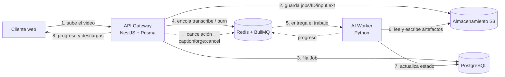

# Arquitectura

CaptionForge se separa en dos procesos que no comparten disco ni memoria: un **API Gateway** que
atiende a las personas usuarias y un **AI Worker** que hace el trabajo pesado (Whisper, ffmpeg,
traducción). Se hablan por una cola (Redis/BullMQ) y por un almacenamiento de objetos (S3); el
contrato de los mensajes vive en [`packages/contracts`](../packages/contracts).

## Quién puede qué

| Actor | PostgreSQL | S3 | Redis |
|---|---|---|---|
| Superusuario del contenedor (`POSTGRES_USER`) | administración; solo lo ve la tarea `pg-roles` | cuenta root: solo la ve `s3-init` | — |
| Dueño del esquema (`cf_owner`, sin superusuario) | DDL; solo lo usa `prisma migrate deploy` (servicio `migrate`) | — | — |
| API Gateway (`cf_api`) | SELECT, INSERT, UPDATE, DELETE; sin DDL | leer, escribir (incl. multiparte) y borrar bajo `jobs/*` | encolar, escuchar eventos, publicar cancelaciones |
| AI Worker (`cf_worker`) | SELECT; UPDATE solo de columnas concretas de `Job` | leer y escribir bajo `jobs/*`; no borra | consumir, reportar progreso, escuchar cancelaciones |

Un rol comprometido no puede borrar tablas, ni leer otros usuarios de la base, ni salir de
`jobs/` en el bucket. [`docker/verify-infra.sh`](../docker/verify-infra.sh) lo comprueba.

## Contratos

Cada mensaje es un esquema JSON versionado (`*.v1.json`); de ahí se generan los tipos TypeScript
y los modelos Pydantic. Los archivos se nombran con `bucket` + `objectKey` (nunca con URLs, ver
[ADR 0002](adr/0002-object-key-en-lugar-de-url.md)).

| Mensaje | Sentido | Cola / canal |
|---|---|---|
| `transcribe-job` / `transcribe-result` | API → worker / worker → API | `captionforge.transcribe` |
| `burn-job` / `burn-result` | API → worker / worker → API | `captionforge.burn` |
| `job-progress` | worker → API | progreso del trabajo de BullMQ |
| `job-error` | worker → API | `failedReason` del trabajo |
| `cancel-message` | API → worker | canal Redis `captionforge:cancel` |

Reglas de la cola: el `jobId` del contrato es el `jobId` de BullMQ (encolar dos veces no
procesa dos veces), `attempts: 1` (un fallo se informa, no se repite en silencio) y el trabajo de
quemado lleva el `etag` de `segments.json` para detectar que los subtítulos cambiaron mientras
tanto (`SEGMENTS_CHANGED`).

## Reglas del worker

Detalladas y verificadas con BullMQ real en [ADR 0006](adr/0006-reglas-del-worker.md):

1. Whisper y ffmpeg corren **fuera del bucle de eventos** (hilo o subproceso); si no, el candado
   del trabajo no se renueva y BullMQ lo marca `stalled`.
2. La cancelación es cooperativa: llega por Redis pub/sub y se traduce en la señal de aborto del
   trabajo en curso.
3. Todo subproceso tiene tiempo máximo y se termina en un `try/finally` (heredado de la
   corrección del paquete `legacy`).
4. El payload se valida en modo estricto (sin coerciones) aunque el API ya lo haya validado.
5. Un solo trabajo pesado a la vez por proceso, aunque haya una cola por tipo (transcribir y
   quemar comparten el mismo hueco). Se escala con más réplicas, no con más concurrencia.
6. El estado del trabajo se escribe con transiciones condicionales (`UPDATE ... WHERE status = ...`):
   el API que cancela y el worker que toma el trabajo compiten con la misma condición y gana uno solo.
7. El quemado lee `segments.json` con `If-Match`: si los subtítulos se editaron después de pedir el
   quemado, falla con `SEGMENTS_CHANGED` en lugar de quemar algo que nadie aprobó.

8. El payload debe quedarse en su alcance aunque cumpla el contrato: `outputPrefix` es exactamente
   `jobs/<su id>/out/` y los buckets de entrada son el configurado; si no, `INTERNAL` sin tocar S3.

## Desarrollo local y despliegue

El compose declara los cinco servicios, pero `api-gateway` y `ai-worker` están en el perfil
`app`: en desarrollo se ejecutan nativos contra la infraestructura dockerizada
([ADR 0007](adr/0007-desarrollo-local-y-perfil-app.md)). Toda la infraestructura cabe en ~125 MB
de RAM.

## Fases

| Fase | Contenido | Estado |
|---|---|---|
| 0 | Paquete actual a `legacy/`, PR #6 y #7 fusionados | Hecha |
| 1 | Monorepo, contratos, compose, roles mínimos, smoke test | Hecha |
| 2 | API Gateway NestJS + Prisma (incluye la migración que concede UPDATE por columna a `cf_worker`) | Hecha |
| 3 | AI Worker Python (modelo cargado una vez, reutiliza los módulos de `legacy`, [ADR 0009](adr/0009-worker-reutiliza-el-paquete-heredado.md)) | Hecha |
| 4a | Flujo de quemado: edición de subtítulos, cola `burn`, descarga con `Range` | Hecha |
| 4b | Adaptación del cliente web al nuevo API | Pendiente |
| 5a | Endurecimiento: clave de API opcional, límites de uso, cierre de trabajos huérfanos, pool de conexiones ([ADR 0010](adr/0010-endurecimiento-del-api-y-trabajos-huerfanos.md)) | Hecha |
| 5b | Autenticación de personas usuarias, observabilidad (métricas, trazas) y despliegue | Pendiente |

## Seguimiento conocido (revisión independiente, 2026-10-21)

Hallazgos de la revisión que **no** se corrigieron en esta rama. Ninguno bloquea el uso local; los
tres primeros son requisito antes de exponer el servicio a Internet.

| Id | Riesgo | Qué falta |
|---|---|---|
| H2 | El API puede quedarse sin memoria con subidas concurrentes (`Upload` con `queueSize: 3` y partes de 8 MiB, ~24-32 MiB por subida frente al límite del contenedor) | Tope de subidas simultáneas o menos paralelismo por subida; límite de memoria y prueba de carga |
| H4 | SSE sin tope de conexiones vivas ni de duración (una consulta por segundo y conexión mientras el trabajo no sea terminal) | Máximo de conexiones por cliente y duración, o sondeo compartido |
| H7 | ffmpeg hereda `DATABASE_URL`, `S3_SECRET_KEY` y `REDIS_PASSWORD`; el contenedor no está endurecido | `env=` mínimo en los subprocesos de `legacy`, usuario sin privilegios, `read_only`, `cap_drop` |
| H9 | CI/CD: workflows sin bloque `permissions`, publicación a PyPI con token de larga vida, imagen sin dependencias fijadas por resumen | `permissions` mínimos, publicación por entorno protegido o Trusted Publishing, versiones fijadas |
| H10 | Sin `API_KEY`, una página externa puede lanzar POST contra un API local (CSRF) o usar DNS rebinding | Comprobar `Host`/`Origin` y cabeceras de seguridad (helmet); `API_KEY` obligatoria fuera de desarrollo |

Además: el apagado ordenado del worker (terminar o devolver el trabajo en curso al recibir SIGTERM) y
la limpieza de `/work` al arrancar siguen sin hacerse, y el paquete `legacy` de PyPI conserva el
riesgo que ya se corrigió en la imagen del worker (PyAV 19 con faster-whisper 1.2.1 sin fijar:
`av==18.1.0` en `apps/ai-worker/constraints.txt`).

H5 (lista HLS disfrazada de video) se investigó y **no es explotable** con ffmpeg 7.1: el worker
guarda la entrada como `input.bin` y la whitelist por defecto de un archivo local bloquea http;
queda una prueba de regresión (`apps/ai-worker/tests/test_ssrf.py`).
