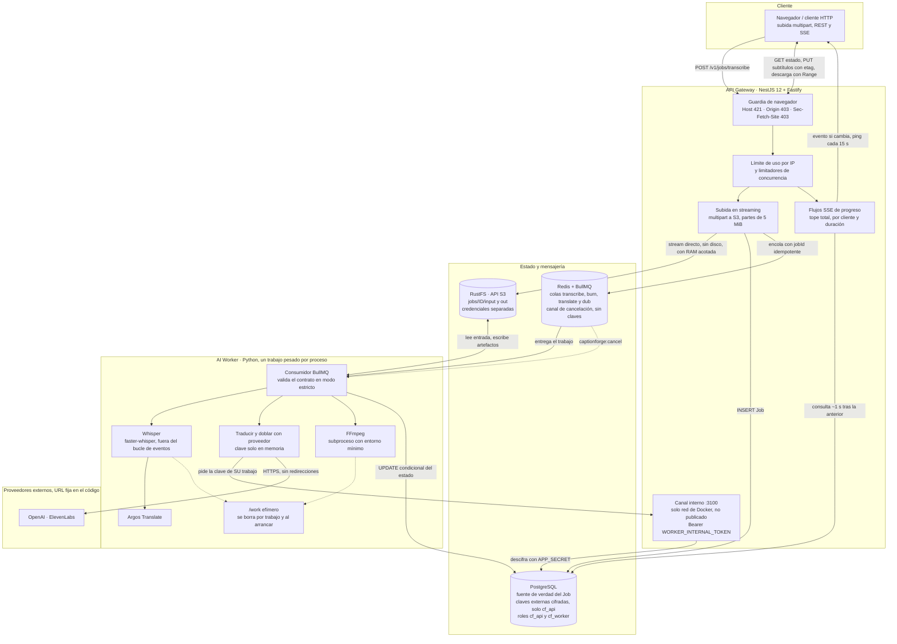

# CaptionForge: arquitectura y postura de seguridad

> Documento de referencia técnica. Las afirmaciones remiten, cuando existe, al código o al ADR que las respalda; lo
> que **no** está resuelto se declara en [Límites declarados](#límites-declarados) en lugar de omitirse.

## 1. Resumen ejecutivo

CaptionForge nació como un **paquete local de un solo proceso** (hoy en [`legacy/`](../legacy)): una interfaz
web FastAPI que, en la misma máquina y en el mismo proceso, recibía un video, lo transcribía con Whisper, lo
traducía con Argos y quemaba los subtítulos con ffmpeg. Funcionaba para una persona con un equipo propio y
se quedaba corto en cuanto había más de una persona: el modelo, el video y la petición HTTP competían por la
misma memoria, y un fallo de ffmpeg o de Whisper compartía proceso con el servidor web.

La reescritura lo separó en un **servicio distribuido y tolerante a fallos** con tres decisiones de fondo:

1. **Dos procesos que no comparten disco ni memoria.** Un API Gateway (NestJS) atiende a las personas usuarias;
   un AI Worker (Python) hace el trabajo pesado. Se hablan por una cola (Redis/BullMQ) y por un almacén de
   objetos S3 (RustFS), con contratos JSON Schema versionados
   ([ADR 0001](adr/0001-contratos-json-schema-como-fuente-de-verdad.md),
   [ADR 0005](adr/0005-bullmq-con-worker-python.md)).
2. **Estado en una sola fuente de verdad.** PostgreSQL guarda el estado del trabajo con transiciones
   condicionales (`UPDATE … WHERE status = …`): si el API que cancela un trabajo en cola y el worker que lo toma
   compiten, gana exactamente uno ([arquitectura](architecture.md#reglas-del-worker), regla 6). Una vez en
   ejecución, la cancelación es cooperativa por pub/sub.
3. **Fallar cerrado.** Cada componente tiene el mínimo privilegio (roles de base de datos y políticas S3
   separados), cada recurso compartido tiene un tope, y ante la duda el sistema rechaza, corta o no ejecuta.

Desde el [issue #11](https://github.com/Bryandero98/captionforge/issues/11) el servicio también traduce y dobla los subtítulos
con proveedores externos (OpenAI, ElevenLabs) usando **las claves propias de cada espacio de trabajo** (BYOK). Una clave de
proveedor es dinero de otra persona, así que tiene su propio régimen: cifrada en reposo, entregada al worker solo por un canal
interno y solo en memoria, nunca por Redis ni por un registro ([sección 3.4](#34-claves-externas-propias-byok-adr-0020)).

El resultado se verifica con pruebas contra PostgreSQL, Redis y S3 reales en contenedores (Whisper real solo en
una prueba opcional; el resto usa un doble), y la cadena de entrega (CI/CD y publicación) está endurecida con los
mismos criterios.

## 2. Diagrama de arquitectura

Quién puede qué (verificado por [`docker/verify-infra.sh`](../docker/verify-infra.sh) y las pruebas de privilegios
de la base de datos del API): el API usa `cf_api`
(DML sin DDL) y una cuenta S3 con lectura, escritura y borrado bajo `jobs/*`; el worker usa `cf_worker`
(`SELECT` y `UPDATE` solo de columnas concretas de `Job`) y una cuenta S3 que **no borra**. Un rol comprometido
no puede borrar tablas ni salir de `jobs/` en el bucket ([arquitectura](architecture.md#quién-puede-qué)). El
mínimo privilegio es por recurso, no por trabajo: ver [Límites declarados](#límites-declarados). La tabla de claves
externas (`TenantExternalKey`) es la excepción más estricta: `cf_worker` no tiene ningún permiso sobre ella.

## 3. Postura de seguridad y hardening (AppSec)

### 3.1 DNS rebinding y CORS/Host fail-closed (H10)

**Amenaza.** El API no usa cookies, así que un token anti-CSRF no protegería nada. Lo que sí está expuesto,
sobre todo ejecutado en `127.0.0.1` sin `API_KEY`, son dos vías de un navegador engañado:

- Un `POST multipart/form-data` cross-origin es una *petición simple*: **no lleva preflight**. Cualquier página
  abierta en la pestaña de al lado podía crear o cancelar trabajos y gastar CPU.
- **DNS rebinding:** un dominio del atacante que resuelve a `127.0.0.1` hace que el navegador lo trate como
  mismo origen y deje **leer** las respuestas.

**Control.** Una guardia pura, con pruebas unitarias y de extremo a extremo
([`request-guard.ts`](../apps/api-gateway/src/security/request-guard.ts)) corre en `onRequest`, antes de
multipart, CORS y límites de uso, de modo que una petición ajena no consume cuota ni procesa su cuerpo:

| Comprobación | Regla | Respuesta |
|---|---|---|
| `Host` | debe estar en `ALLOWED_HOSTS` (por defecto `localhost`, `127.0.0.1`, `[::1]`); cabecera ausente o malformada también falla | **421** |
| `Origin` | si existe, debe estar en `ALLOWED_ORIGINS` (vacío por defecto) o ser el propio origen del API; `Origin: null` se rechaza | **403** |
| `Sec-Fetch-Site` | sin `Origin`, un método que modifica con `cross-site` o `same-site` | **403** |

Decisiones de diseño que importan:

- **Fail-closed y sin comodines.** `ALLOWED_ORIGINS` vacío significa «solo mismo origen». `*`, puertos en la
  lista de hosts o valores ambiguos **hacen fallar el arranque**: una configuración peligrosa no se interpreta
  con indulgencia, no arranca.
- **CORS solo con lista cerrada** y `credentials: false`; si no hay orígenes, ni siquiera se registra.
- **`/health` es la única excepción, y está acotada.** Se exime solo a los sondeos reales (`GET` o `HEAD` sin
  `Origin` ni marca de otro sitio), y esa exención **tampoco comprueba `Host`**: los sondeos del orquestador
  llegan con el nombre del pod. Un `` de una página ajena en un navegador que envía
  `Sec-Fetch-Site` recibe 403 antes de ejecutar `SELECT 1` y los pings a Redis y S3. Con DNS rebinding el navegador
  declara `same-origin` y la ruta responde, pero solo con el estado de las dependencias y bajo su propio contador
  (600 por minuto); no expone datos de trabajos.
- **Sin reflejo.** Los mensajes de error son fijos y no repiten el `Host` ni el `Origin` recibidos; los
  rechazos con el cuerpo sin leer descartan hasta 16 MiB (10 s) y entonces cortan, para que el navegador vea el error.
- **Observable.** Al arrancar se registra la política efectiva, de modo que un `ALLOWED_HOSTS` mal puesto se ve
  en el log y no en producción.

Detalle, alternativas descartadas (token anti-CSRF, solo CORS, `API_KEY` obligatoria) y consecuencias en
[ADR 0011](adr/0011-origen-y-host-fail-closed-contra-paginas-ajenas.md).

### 3.2 Aislamiento de secretos en subprocesos (H7)

ffmpeg procesa bytes que controla quien sube el video. Si heredara el entorno del worker, un fallo en un
decodificador tendría a mano `DATABASE_URL`, las claves S3 y la de Redis. Por eso
[`ffmpeg_env()`](../legacy/src/captionforge/ffmpeg_locator.py) construye el entorno del subproceso con una
**lista blanca** (rutas, locale, `XDG_*`, `FONTCONFIG_*`, `TZ`) en lugar de heredar `os.environ` y restar lo
sensible: una variable nueva con un secreto queda fuera **por defecto**, sin que nadie tenga que acordarse de
excluirla. Se aplica a los lanzamientos que procesan entrada no confiable: la extracción de audio y el quemado
(`pipeline.py`) y la forma de onda (`waveform.py`).

Complemento a nivel de datos: el worker no tiene `DELETE` en S3 ni `INSERT`/`DDL` en PostgreSQL, y el payload
se valida contra su alcance (`outputPrefix` es exactamente `jobs/<su id>/out/`; las entradas, por el bucket
configurado y el patrón `jobs/<uuid>/…` del contrato; si no, falla sin tocar S3). Una lista HLS disfrazada de
video **no es explotable** con ffmpeg 7.1 (prueba de regresión en `apps/ai-worker/tests/test_ssrf.py`), pero
ese resultado descansa en valores por defecto —la entrada se guarda como `input.bin` y la lista blanca de
protocolos de ffmpeg para archivos locales—, no en una restricción explícita.

### 3.3 Cadena de suministro segura (H9)

El flujo de entrega es un objetivo en sí mismo: quien controle un paso del CI puede publicar código propio con
tu identidad. Lo que se aplicó y **se comprueba en cada PR**:

- **Mínimo privilegio del `GITHUB_TOKEN`.** Cada workflow declara `permissions: contents: read` a nivel global;
  los permisos de escritura se piden solo en el job que los usa.
- **Acciones fijadas por SHA de 40 caracteres** (con el tag en un comentario) y, para `docker://`, por resumen
  `sha256`: un tag movido o un repositorio de acciones comprometido no cambia lo que se ejecuta.
- **Publicación en PyPI sin secretos de larga vida (Trusted Publishing / OIDC).**
  [`release.yml`](../.github/workflows/release.yml) se divide en dos jobs: `build` compila con solo lectura y
  **no puede** pedir el token OIDC (si una herramienta de compilación se comprometiera, no podría publicar), y
  `publish` solo descarga el artefacto y lo sube, con `id-token: write` y `environment: pypi`. El workflow ya no
  usa `PYPI_API_TOKEN`: PyPI valida la identidad del workflow y emite un token efímero por ejecución (queda
  retirar el secreto antiguo y proteger el entorno, ver límites).
- **El control no depende de la disciplina.**
  [`tools/check-workflows.mjs`](../tools/check-workflows.mjs) analiza el **árbol YAML** (no el texto) y falla si
  falta `permissions` global, hay `write`/`write-all` global, o cualquier `uses` carece de SHA. Tiene 10 pruebas,
  incluidas las elusiones que burlaban una primera versión basada en expresiones regulares (comillas, mapas de
  una línea, alias YAML, `docker://alpine:latest`). Corre en el job de contratos del CI.
- **Lo fijado no se pudre.** [`dependabot.yml`](../.github/dependabot.yml) revisa cada semana acciones, las dos
  imágenes Docker, compose, npm y los dos paquetes Python (con minor y patch agrupados donde procede): fijar sin
  actualizar congelaría también las correcciones de seguridad.

### 3.4 Claves externas propias (BYOK, ADR 0020)

**Amenaza.** Traducir con OpenAI o doblar con OpenAI o ElevenLabs cuesta dinero, y lo paga la persona dueña de la clave. Una
clave de proveedor que se filtra se gasta sin que nadie lo note hasta la factura. Las vías realistas son: un volcado de la base,
Redis (que aquí no va cifrado en memoria y guarda el payload de cada trabajo), un registro o un mensaje de error que repita la
clave (OpenAI lo hace: «Incorrect API key provided: sk-…»), un Editor o una clave de API que gestione claves ajenas, y un
servidor que envíe la clave a un destino que no es el proveedor (SSRF o redirección).

**Control.** Seis decisiones encadenadas:

| Decisión | Qué hace | Dónde está |
|---|---|---|
| Cifrado en reposo | AES-256-GCM con IV aleatorio de 96 bits. La clave de cifrado se *deriva* de `APP_SECRET` con HKDF-SHA256 (el secreto crudo no se usa como clave). El dato autenticado adicional (AAD) une el espacio, el proveedor y la versión de la clave (`tenantId`, `provider`, `keyVersion`): un cifrado copiado a otra fila (otro espacio u otro proveedor) no descifra. Formato guardado: `v1` seguido de IV, etiqueta y datos en base64url, separados por puntos. | [`external-key-crypto.ts`](../apps/api-gateway/src/external-keys/external-key-crypto.ts) |
| `APP_SECRET` validado al arrancar | Debe ser aleatorio (hexadecimal de 64 caracteres o base64) de 32 bytes o más. Si está definido y es débil, el API **no arranca**. Si falta, la función queda **apagada** (`capabilities.byok.enabled = false`, 404 en las rutas de claves, 409 `byok_disabled` al crear trabajos): nunca se cifra con un valor por defecto. Solo el API lo recibe; el worker no. | [`config.ts`](../apps/api-gateway/src/config/config.ts), [`docker-compose.yml`](../docker-compose.yml) |
| Gestión solo del Dueño con sesión | Guardar, reemplazar y borrar exigen rol Dueño **y** sesión de persona: las claves de API (que actúan como Editor) no pueden. La API nunca devuelve la clave: solo proveedor, últimos 4 caracteres y fechas, con `Cache-Control: no-store`. Una clave tiene 20 o más caracteres, de modo que esos 4 no son más de la quinta parte. El Editor *usa* las claves al lanzar trabajos; el Lector no lanza trabajos. | [`external-keys.controller.ts`](../apps/api-gateway/src/external-keys/external-keys.controller.ts), [`external-key-format.ts`](../apps/api-gateway/src/external-keys/external-key-format.ts) |
| El worker no lee la base | `cf_worker` no tiene ningún permiso sobre `TenantExternalKey`, y `APP_SECRET` no está en su entorno: ni el cifrado ni el secreto están a su alcance. | [`init-roles.sql`](../docker/postgres/init-roles.sql) |
| Canal interno | El worker pide la clave **de su trabajo** con `POST /internal/v1/jobs/:jobId/external-key` a un listener en un puerto aparte (3100) que solo existe en la red de Docker: no está en `ports:` ni lo enruta Caddy. Exige `Authorization: Bearer <WORKER_INTERNAL_TOKEN>` (comparación en tiempo constante, 120 peticiones por minuto por defecto, cuerpo de 1 KiB como máximo). El espacio sale de la fila del trabajo, nunca del cuerpo; el trabajo debe estar `RUNNING`, ser `TRANSLATE` o `DUB` y haber declarado ese proveedor. Sin `WORKER_INTERNAL_TOKEN` el canal no se abre. | [`internal-server.ts`](../apps/api-gateway/src/internal/internal-server.ts), [`external_key.py`](../apps/ai-worker/src/ai_worker/external_key.py) |
| La clave solo vive en memoria | Llega envuelta en un `Secret`, se registra en el censor de registros desde ese instante y se borra al terminar el trabajo. El payload de BullMQ lleva solo el proveedor y las opciones, así que Redis nunca la ve. Los mensajes de error son texto propio (códigos `EXTERNAL_*`), nunca el del proveedor ni la traza de la petición. | [`external_key.py`](../apps/ai-worker/src/ai_worker/external_key.py), [`provider_http.py`](../apps/ai-worker/src/ai_worker/provider_http.py) |

Complementos que cierran vías concretas:

- **SSRF y reenvío de la clave.** Las URL de OpenAI y ElevenLabs están fijas en el código
  ([`adapters.py`](../apps/ai-worker/src/ai_worker/adapters.py)); ninguna opción de trabajo ni variable de una persona las
  cambia. Las llamadas no siguen redirecciones ni usan los proxies del entorno, y la dirección del canal interno se valida
  (sin credenciales ni ruta).
- **Gasto acotado.** Cada trabajo de traducción o doblaje tiene un tope de `MAX_JOB_CHARACTERS` (50 000 por defecto) y
  `MAX_JOB_SEGMENTS` (1 000): el API responde 413 `job_too_large` antes de encolar y el worker lo vuelve a comprobar. Si falta
  la clave o la función está apagada, 409 antes de encolar. Hay un solo trabajo activo de cada tipo por transcripción. La
  interfaz pide confirmación con la estimación «≈ N caracteres» antes de enviar texto a un proveedor externo.
- **Degradación elegante.** 401, 402 y 403 del proveedor no se reintentan; 429 y 5xx se reintentan con retroceso exponencial
  y respetando `Retry-After` (acotado). El resultado es un código estable (`EXTERNAL_AUTH_FAILED`, `EXTERNAL_QUOTA_EXCEEDED`,
  `EXTERNAL_RATE_LIMITED`, `EXTERNAL_TIMEOUT`, `EXTERNAL_UNAVAILABLE`, `EXTERNAL_KEY_MISSING`, `JOB_TOO_LARGE`) que la
  interfaz muestra traducido.
- **Modo local.** Sin sesión (`LOCAL_MODE=true`) la interfaz no ofrece BYOK: no hay panel «Claves externas» y «Doblar» queda
  bloqueado con una explicación. «Traducir» sigue con Argos, sin clave ni costo.

**Cómo se prueba.** Contra PostgreSQL y Redis reales:
[`db-privileges.spec.ts`](../apps/api-gateway/test/db-privileges.spec.ts) fija que `cf_worker` no toca la tabla;
[`external-key-crypto.spec.ts`](../apps/api-gateway/test/external-key-crypto.spec.ts) cubre cifrado, AAD y manipulación;
[`external-keys.e2e.spec.ts`](../apps/api-gateway/test/external-keys.e2e.spec.ts) recorre la matriz de roles y
`no-store`; [`internal-key.e2e.spec.ts`](../apps/api-gateway/test/internal-key.e2e.spec.ts) las condiciones del canal;
[`compose-internal.spec.ts`](../apps/api-gateway/test/compose-internal.spec.ts) falla si alguien publica el puerto interno
en `ports:`. La prueba **canario** ([`leak-canary.e2e.spec.ts`](../apps/api-gateway/test/leak-canary.e2e.spec.ts)) hace
recorrer a una clave señuelo el camino completo (guardado, cifrado, entrega, uso, un proveedor que la repite en su error, una
excepción sin capturar) y la busca, en claro y en formas triviales (base64, URL, trozos), en Redis (con `DUMP`), la base, los
registros del API, la salida del worker y la carpeta de trabajo; un control negativo comprueba que el escáner sí detecta una
fuga hecha a propósito.

**Rotación de `APP_SECRET` e impacto de perderlo.** Los scripts de arranque lo generan una vez (32 bytes aleatorios) y nunca lo regeneran.
Sin él, o con otro valor, el descifrado falla: el canal interno responde 500, el worker reintenta y el trabajo termina en
`EXTERNAL_UNAVAILABLE`; las filas siguen en la base, pero ya no sirven. Con el valor ausente o vacío la función queda apagada
(409 `byok_disabled`) y se recupera restaurando el mismo valor. Procedimiento de rotación (detalle en el [runbook](runbook-app-secret.md)):

1. Avisar a los Dueños: tendrán que volver a pegar sus claves.
2. Parar `api-gateway` y `ai-worker`.
3. Vaciar `"TenantExternalKey"` con el rol dueño de la base.
4. Poner el nuevo `APP_SECRET` (hex de 64 caracteres) en `.env` y levantar los servicios.
5. Cada Dueño pega de nuevo sus claves. `WORKER_INTERNAL_TOKEN` se rota sin pérdida: se cambia en `.env` y se reinician ambos servicios a la vez.

**Qué NO protege.**

- Quien tenga `APP_SECRET` **y** la base (o un respaldo de ella) puede descifrar todas las claves. Por eso `APP_SECRET`
  se guarda fuera de la base y de sus respaldos ([runbook](runbook-app-secret.md)).
- No hay rotación automática de `APP_SECRET`: el esquema guarda `keyVersion`, pero el comando de re-cifrado está aplazado.
  Cambiar o perder el secreto deja ilegibles las claves guardadas, que cada Dueño vuelve a pegar.
- El proveedor cobra de todos modos: los topes por trabajo y la confirmación reducen el error y el abuso, pero no impiden
  que un Editor lance muchos trabajos. Los topes diarios y mensuales por espacio quedan para el
  [issue #13](https://github.com/Bryandero98/captionforge/issues/13) (v1.1).
- Redis no va cifrado en memoria; por eso la clave no pasa por él. Eso no protege contra un worker comprometido: tiene la
  clave de su trabajo en memoria mientras corre.
- El token interno no distingue un trabajo «suyo» de otro: quien lo tenga puede pedir la clave de **cualquier** trabajo
  `TRANSLATE` o `DUB` en curso (no las de trabajos terminados ni de otro tipo). Se rota sin pérdida de datos.
- Un Dueño con la sesión secuestrada puede reemplazar o borrar las claves del espacio. El registro dice quién las guardó o
  reemplazó, no guarda un historial de valores.

Decisiones, alternativas descartadas y pre-mortem en el
[ADR 0020](adr/0020-ia-avanzada-y-claves-externas-byok.md). Operación del secreto: [runbook de `APP_SECRET`](runbook-app-secret.md).

### Límites declarados

La seguridad creíble nombra lo que no cubre:

| Id | Límite | Siguiente paso |
|---|---|---|
| H7b | El entorno mínimo evita la herencia **accidental** de secretos; no frena un ffmpeg ya comprometido que corra con el mismo usuario (podría leer `/proc/<padre>/environ`). El worker ya corre sin root y con `no-new-privileges`. | ffmpeg con otro usuario o en otro contenedor, y perfil seccomp con sistema de archivos de solo lectura. |
| Imágenes | Las imágenes base (`node`, `python`, `postgres`, `redis`) se fijan por etiqueta, no por resumen `sha256`; `build==1.6.1` se instala sin hashes de sus dependencias; `check-workflows` valida la forma del SHA, no que corresponda al tag del comentario. | Fijar por resumen, instalar con `--require-hashes` y verificar SHA y tag. |
| Propiedad | Cada trabajo pertenece a un tenant y toda consulta lo filtra (otro tenant ve 404; ADR 0015). Con `LOCAL_MODE=true` (instalación de una persona) la clave del tenant «Default» se entrega a la interfaz en `/web-config.json`, de modo que quien alcance el puerto actúa como ese tenant; con `LOCAL_MODE=false` hay que iniciar sesión (GitHub o Google, ADR 0016) y esa ruta no entrega nada. El límite de uso por IP depende de `TRUST_PROXY` (con `true` se falsifica por `X-Forwarded-For`). | Cuotas por tenant: subidas por hora y trabajos en curso, con fail-open si Redis cae (ADR 0017). En producción, `LOCAL_MODE=false`. |
| Alcance interno | Dentro de `jobs/*`, el worker puede sobrescribir objetos de cualquier trabajo y actualizar `status`/`result` de cualquier fila (permisos por columna, no por fila). | Credenciales o políticas por trabajo; hoy se confía en que el worker es código propio. |
| OIDC | El workflow está listo, pero el publicador de confianza hay que registrarlo en PyPI (repositorio, `release.yml`, entorno `pypi`) y crear el entorno en GitHub con revisores obligatorios. Es un paso manual del mantenedor; hasta entonces `PYPI_API_TOKEN` puede seguir en la configuración del repositorio y de PyPI. | Registrar el publicador y retirar el secreto antiguo. |
| 5b | Con inicio de sesión (ADR 0016) la premisa de 3.1 cambió: la cookie `cf_session` es `HttpOnly`, `SameSite=Lax` y `Secure` (prefijo `__Host-`) bajo https; las peticiones que modifican con sesión exigen `X-Requested-With: captionforge`; la guardia de `Origin` queda como defensa en profundidad. Una clave de API inválida nunca cae a la cookie. | Fase 5b. |
| BYOK | Las claves externas (ADR 0020, [3.4](#34-claves-externas-propias-byok-adr-0020)) se cifran con una clave derivada de `APP_SECRET`: quien tenga el secreto y la base las descifra. No existe re-cifrado ni rotación de `APP_SECRET` (el esquema ya guarda `keyVersion`); cambiarlo o perderlo obliga a que cada Dueño vuelva a pegar sus claves. El token interno permite pedir la clave de cualquier trabajo `TRANSLATE` o `DUB` en curso, y un worker comprometido ve la clave de su trabajo. Hay topes por trabajo, no diarios ni mensuales por espacio. | Comando de re-cifrado con `APP_SECRET_PREVIOUS`, token por trabajo y topes por espacio (el último, en el [issue #13](https://github.com/Bryandero98/captionforge/issues/13), v1.1). |
| Equipos | Un espacio de trabajo lo comparten personas con rol Dueño, Editor o Lector (ADR 0019). `RolesGuard` exige Lector en métodos seguros y Editor en los demás, y Dueño para claves, miembros e invitaciones; sin rol declarado deniega, y una prueba paramétrica recorre todas las rutas. Las claves de API actúan como Editor. Una invitación es un enlace de un solo uso (256 bits, solo su SHA-256 en la base, vence en 7 días) **sin verificar correo**: quien lo abra primero se une con el rol ofrecido. El último Dueño no se puede quitar ni degradar (bloqueo de filas en transacción) y nadie se queda sin ningún espacio (cerrojo consultivo por persona). Quien deja de ser Dueño pierde sus invitaciones sin usar y sus claves de API en la misma transacción. | Si se necesita atar la invitación a una persona: restringir por correo verificado. |

## 4. Resiliencia y optimización de hardware

Los topes de uso y de concurrencia son configurables (`0` los desactiva; otros valores, como el límite de
tamaño de subida, el de `/health` o las partes de 5 MiB, son fijos o exigen un valor positivo) y comparten una idea: **un recurso compartido nunca debe
depender de que el cliente se porte bien**.

### 4.1 Memoria acotada: streams directos a S3 (H2)

Un video puede pesar varios GiB; cargarlo en memoria para subirlo llevaría al contenedor a un OOM con unas pocas
subidas simultáneas. El API **no guarda el video**: lo encauza como flujo desde la petición a S3 mediante
**subida multiparte con partes de 5 MiB**
([`storage.service.ts`](../apps/api-gateway/src/storage/storage.service.ts)). Cada subida retiene como mucho unas pocas
partes (cola de 2 más la que se envía, unos 15 MiB por configuración), no el tamaño del archivo; la prueba de
memoria de CI mide ~105-115 MiB de crecimiento de RSS con cuatro subidas simultáneas de 64 MiB, costes fijos
incluidos, y se declara un detector de retención, no una medida fina. El límite de tamaño se aplica contando
bytes sobre la marcha (413) en lugar de fiarse de `Content-Length`.

Una subida lenta también es un recurso retenido, así que:

- **Tope de subidas a la vez**: total (por defecto 4) y por cliente (por defecto 2).
- **Ritmo mínimo** de 16 KiB/s (128 kbit/s) medido por ventanas de 30 s: un goteo de bytes que retiene la
  plaza se corta con 408. Se mide en los bytes que pasan hacia S3, así que una contrapresión fuerte del
  almacenamiento también puede provocarlo; es configurable.

En el worker, el video tampoco vive en RAM: se descarga a un directorio por trabajo y se procesa con Whisper y
ffmpeg **fuera del bucle de eventos** (hilo o subproceso), de modo que el candado de BullMQ se sigue renovando y
no aparecen falsos `stalled`.

### 4.2 Concurrencia y agotamiento de sockets (H4)

El límite por minuto cuenta cuántas peticiones *empiezan*, no cuántas siguen vivas; y un flujo SSE puede durar
horas mientras un trabajo espera en cola. Un [`ConcurrencyLimiter`](../apps/api-gateway/src/security/concurrency-limiter.ts)
reserva un **hueco** por flujo antes de consultar nada:

| Control | Por defecto | Qué previene |
|---|---|---|
| `MAX_EVENT_STREAMS` | 200 | Agotar los descriptores de archivo y el pool de conexiones a PostgreSQL |
| `MAX_EVENT_STREAMS_PER_CLIENT` | 10 | Que una sola IP acapare todos los huecos (429 con `Retry-After`) |
| `EVENT_STREAM_MAX_SECONDS` | 1800 | Flujos eternos: el servidor cierra y `EventSource` reconecta solo, recibiendo el estado completo |

El hueco se libera al cerrarse la conexión, al fallar y al completarse; en los flujos SSE, un vencimiento de
seguridad (duración máxima más 60 s) lo libera igual si el evento de cierre nunca llegara. Es una contabilidad:
no cierra el socket. Cada flujo consulta aproximadamente una vez por segundo, emite un evento solo si cambia el
estado, la etapa, el porcentaje o el mensaje, y envía un `ping` cada 15 s para mantener la conexión; el coste
por conexión es predecible.

Del lado del worker, la concurrencia es deliberadamente baja: **un trabajo pesado a la vez por proceso**
(transcribir y quemar comparten hueco) y se escala con réplicas, no con hilos, porque Whisper y ffmpeg son lo
que agota la RAM. `attempts: 1` evita que un fallo se reintente en silencio y se multiplique la carga.

### 4.3 Apagado ordenado y volúmenes efímeros

Los contenedores se detienen en cada despliegue; lo que importa es lo que queda detrás.

- **Apagado con plazo.** Ante `SIGTERM`/`SIGINT` el worker deja de tomar trabajo y espera al que está en curso
  hasta `SHUTDOWN_GRACE_SECONDS` (45 s por defecto, por debajo de los 60 s de `stop_grace_period` de Docker).
  Si el plazo se agota, **pide parar** el trabajo (el corte es cooperativo: hilo de Whisper y ffmpeg, con 10 s
  más de margen), lo cierra como fallido con un mensaje claro y libera la conexión. Sin el plazo,
  `Worker.close()` espera sin límite, Docker mata el proceso a los 60 s y la fila quedaba en `RUNNING` hasta que
  el recolector la cerraba (20 min por defecto).
- **Nada queda en `/work`.** Cada trabajo borra su carpeta en un `finally` (`transcribe.py`, `burn.py`), porque
  un video de 4 GiB olvidado llena el volumen en pocos trabajos. En S3, el ciclo de vida del bucket expira lo de
  `jobs/` pasado un día.
- **Limpieza de lo que ningún `finally` alcanza.** Si el proceso muere por OOM o `SIGKILL`, no hay `finally`.
  Al arrancar, [`clean_stale_work`](../apps/ai-worker/src/ai_worker/workdir.py) borra las carpetas `<jobId>/` de
  `/work` cuyo trabajo ya no está vivo; conserva las de trabajos con latido reciente (otra réplica puede
  compartir el volumen) y solo toca nombres que son un UUID, de modo que no destruye modelos ni notas.
- **Trabajos huérfanos.** En el lado del API, un recolector cierra como fallidos los trabajos `RUNNING` sin
  latido o los `QUEUED` que la cola perdió
  ([ADR 0010](adr/0010-endurecimiento-del-api-y-trabajos-huerfanos.md)): el usuario ve un error accionable,
  no un progreso que no avanza.

### 4.4 Incidentes que estas decisiones evitan

| Incidente en producción | Mecanismo que lo evita |
|---|---|
| Contenedor del API muere por OOM con pocas subidas de video | Streaming multiparte de 5 MiB + tope y ritmo mínimo de subidas |
| Pool de PostgreSQL y sockets agotados por pestañas con SSE abiertas | Tope total y por cliente, duración máxima, emisión solo ante cambios |
| Una página abierta en la otra pestaña lanza o cancela trabajos | Guardia `Origin`/`Sec-Fetch-Site`; CORS de lista cerrada |
| El navegador lee el API local desde un dominio del atacante | Validación de `Host` (421) contra DNS rebinding |
| Secretos de infraestructura al alcance de un decodificador de video | Entorno de ffmpeg por lista blanca; roles de mínimo privilegio |
| Una dependencia del CI comprometida publica un paquete con tu nombre | Acciones por SHA, `permissions` de solo lectura, OIDC con jobs separados |
| Despliegue deja trabajos zombis y el disco lleno de videos | Apagado con plazo, `finally` por trabajo, limpieza de `/work` al arrancar |
| Cancelar y arrancar un trabajo a la vez deja un estado incoherente | Transiciones condicionales en PostgreSQL: gana exactamente uno |
| Una clave de OpenAI o ElevenLabs se filtra por la base, Redis, un registro o el error de un proveedor | Cifrado AES-256-GCM con AAD, `cf_worker` sin acceso a la tabla, canal interno con la clave solo en memoria, mensajes propios y prueba canario |
